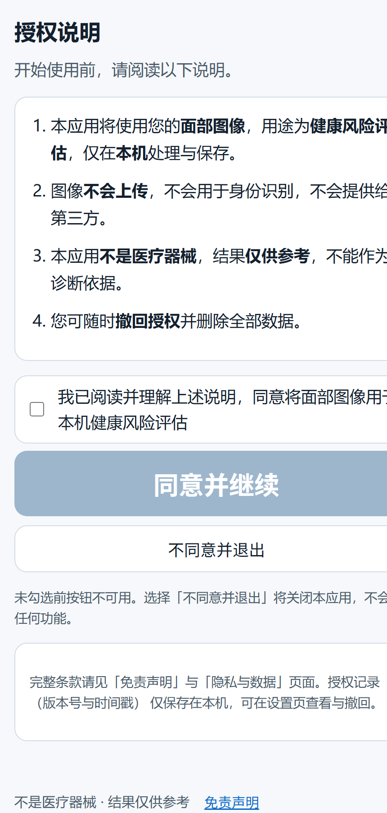
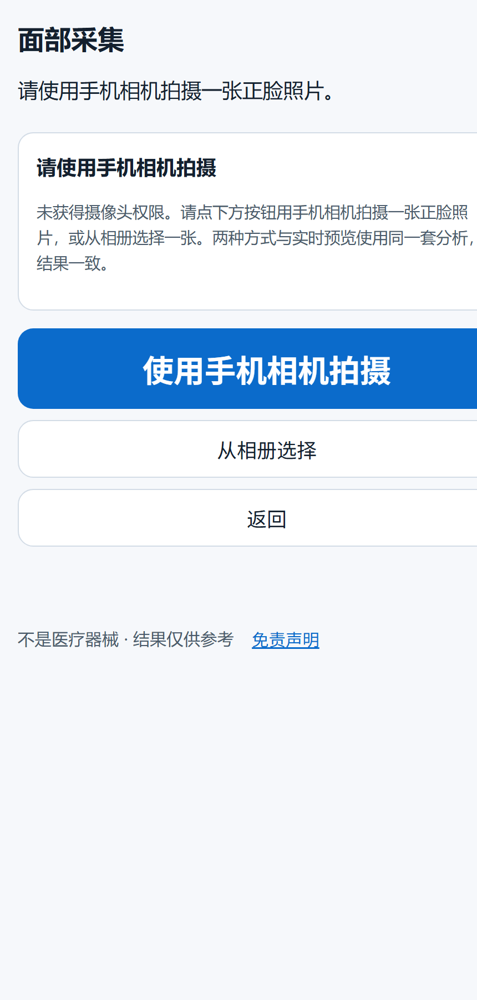

# FaceStroke

安卓手机上量一量左右脸差多少。478 个面部关键点 → 归一化 → 对称度；再加上一条面部区域颜色的测量。
全部在手机本地算，照片不落盘、不上传、不需要账号。

**它不是诊断工具，不输出卒中概率，也不能替代任何检查。** 请先读完下面这段再决定要不要用。

---

## 关于这个名字

项目立项时冲着"卒中预警"去的，所以名字里带了个 stroke。做到一半发现两件事，只好掉头：

第一，急性缺血性卒中的面部表现是**运动体征**——口角歪斜、一侧下垂，那是形状；
能从一张正面照上稳定量出来的是**对称度**，不是"有没有卒中"。这两件事经常被混着说。

第二，我们手上唯一能拿到的公开数据集，标签和采集来源几乎完全重叠。
用它训练出来的模型能刷出很高的指标，但学到的是"这张图是从哪个来源抓的"，不是病理。
这种情况下报出去的准确率是骗人的。

所以现在这个仓库里留下的是**测量**：把一张脸左右差多少、面部各区域颜色差多少量出来，
附上误差范围，跟自己比。判断留给医生。名字没改，因为改一次要动包名、Android 工程和一堆引用，
不值当，不如把话在 README 里说清楚。

---

## 现在是什么样子

<p align="center">
  
  &nbsp;&nbsp;
  
</p>

截图是在桌面浏览器里跑的，没有摄像头权限，所以采集页显示的是手动拍照的兜底入口；
在真机上会直接进实时取景。

---

## 跑起来

需要 Node 20+ 和 npm。想打包 APK 的话还要 JDK 17+ 和 Android SDK。

```bash
cd web
npm install
```

然后把 MediaPipe 和 onnxruntime 的 wasm 从 `node_modules` 复制到 `public/` —— 应用完全离线运行，
不向任何 CDN 请求资源，所以这两份文件必须放在包里：

```powershell
# Windows PowerShell，在仓库根目录
powershell -ExecutionPolicy Bypass -File scripts\bootstrap-assets.ps1
```

跑开发服务器：

```bash
cd web
npm run dev -- --host
```

注意：浏览器要求 `getUserMedia` 走 HTTPS，局域网里用手机打开 `http://192.168.x.x:5173` 摄像头会被拒。
要么用隧道（如 `cloudflared tunnel --url http://localhost:5173`），要么直接用 Android 包测试。

### 打包 Android

```powershell
powershell -ExecutionPolicy Bypass -File scripts\build-apk.ps1 -JavaHome "C:\path\to\jdk-17" -AndroidSdk "$env:LOCALAPPDATA\Android\Sdk"
```

脚本会做四件事：`vite build` → `cap sync android` → `gradlew assembleDebug` → 把 APK 复制到 `apk/`。
没有签名配置，产出的是 debug 包，不能上架。

包名 `com.facestroke.app`，`minSdk 24`，`targetSdk 36`。

---

## 它是怎么算的

两条通道，互相独立，结果页也是分开呈现的。

**几何通道（主力）**

1. MediaPipe FaceLandmarker 出 478 个点；
2. 建规范坐标系：原点取两眼中点，尺度取内眼角间距，纵轴由鼻根（168）指向下巴（152）定出来；
3. 220 对镜像点两两比较左右距离差，取绝对值；
4. 四个区（额纹、眼睑、鼻唇、口周）分别求均值，再合成一个总体不对称度 `A`；
5. 分数 `S = 100 × (1 − clip((A − a_ref) / (a_max − a_ref), 0, 1))`。

那 220 对镜像点不是按编号猜的，是 `train/derive_mirror_pairs.py` 从数据里算出来的：
把每个模板点按中线镜像，保留互为最近邻的点对。
`a_ref / a_max` 取自 794 张正脸的分布（中位数 / 99 分位），**这两个数是临时值**，
换了数据或改了预处理都要重标，`web/src/core/symmetry.js` 里标了 `provisional: true`。

**颜色通道**

按内眼角间距为单位划出五个区域（印堂、上鼻、口周、双颊），各自求 LAB 中位数与色度比值，
再做区域之间相减。相减能一阶抵消曝光和白平衡的漂移 —— 前提是两块皮肤被同一盏灯、同一次白平衡照到。
高光截断抵消不了，所以每个区域都会统计饱和像素比例，超了直接拒拍。

**质量门控**

亮度、清晰度（拉普拉斯方差）、偏航、人脸占比、嘴部遮挡五个维度，全部是确定性阈值，
不用模型。阈值是从一组"故意拍坏"的对照图里标出来的（避免"全部拒绝"蒙对），
但**只在旧固定工位的条件下标定过**，手持自拍要重标。

---

## 仓库结构

```
web/
  src/core/        算法层：landmarks / symmetry / quality / cnn / fusion / report / policy …
  src/screens/     12 个页面，一个页面一个文件，没有框架，靠 main.js 的哈希路由串起来
  src/styles/      app.css
  tests/           153 个测试，node --test 直跑，不需要浏览器
  public/          face_landmarker.task 随仓库提供；wasm 由 bootstrap 脚本复制
  android/         Capacitor 工程（cap sync 产物不入库）
train/             Python：关键点配对推导、质量模型、颜色研究、四网络集成（框架代码，不含数据）
scripts/           环境与打包脚本
docs/              架构、限制、数据与伦理
```

---

## 测试

```bash
cd web
npm test
```

153 个用例，覆盖文案红线扫描、报告生成、干扰判定、趋势、镜像对称、质量门控的像素级回归。
其中 7 个用例需要 `work/badset/` 里的回归图片，那份数据不随仓库分发，缺了会自动 skip 而不是假装通过：

```
tests 153 … pass 146 … skipped 7 … fail 0
```

还有一个静态检查，扫一遍源码里有没有外部 URL、内部文档路径之类的泄漏：

```bash
node scripts/scan_sources.mjs
```

---

## 已知问题

摆出来，不藏着。

- **没在足够多的真机上验证过。** 只在两三台国产 Android 上跑通过，换机型、换系统 WebView 版本后
  MediaPipe 的 wasm 加载和摄像头权限行为都可能不一样。
- **白平衡锁不住。** WebView 拿不到相机的白平衡控制，"锁定白平衡"这条路在 Capacitor 里走不通。
  颜色通道因此只在同光位、同设备的条件下可信。真要解决得写原生相机插件（Camera2），这是当初就规划好的下一步。
- **侧脸和遮挡没有认真处理。** 偏航用的是"鼻尖到两外眼角的距离差 / 眼距"这种粗代理；
  遮挡只看了嘴部区域的清晰度比，口罩斜着戴、手遮半边脸都容易漏。
- **对称度的 a_ref / a_max 是临时标定值。** 换数据必须重标，否则分数的绝对位置没有意义。
- **四个网络那一支（Xception / ResNet50 / VGG19 / EfficientNetB1，照 Aging Cell 2024 的框架搭的）
  权重没有入库。** 理由有两个：那四个骨干合计 763 MB，装不进手机；更重要的是，没训练过的权重
  放进包里只会让人误以为能用。仓库里有导出脚本和占位配置，真要用自己训练。
- **结果页的措辞还在改。** 之前有过"风险百分比""红黄绿"这类设计，都被自己去掉了，理由是
  出来的东西形状决定别人怎么理解它：给百分比会被当成发病概率。

---

## 数据与伦理

这个仓库**不包含任何数据集，也不包含训练权重**。原因写在 `docs/DATA-AND-ETHICS.md`：
我们最初用的那批图来自一个已被 Kaggle 下架的数据集，标签与采集来源高度重叠，
用它做出来的任何指标都不能代表真实性能。把那份数据再散布一遍既没有权利，也没有道理。

`train/` 里的脚本是能跑的，但要你自己准备数据，并且自己确认数据的来源和许可。
脚本默认路径是仓库相对路径，`work/datasets/` 放什么都由你决定，那份目录在 `.gitignore` 里。

如果你要拿这个项目做研究，请先看 `docs/LIMITATIONS.md` 里的"这个测量能证明什么、不能证明什么"一节。

---

## 许可

代码用 MIT，见 [LICENSE](LICENSE)。随仓库分发的 MediaPipe 模型与 onnxruntime 是 Apache-2.0 / MIT，
各自的声明见 [NOTICE.md](NOTICE.md)。

**软件许可不等于数据许可**：本项目没有任何数据，用户自己拍的照片怎么用、能不能留，由用户和所在机构决定。

---

## 改动记录

见 [CHANGELOG.md](CHANGELOG.md)。版本号是 `v1.5.0`，对应仓库里这套四网络框架搭完、权重未入库的状态。
